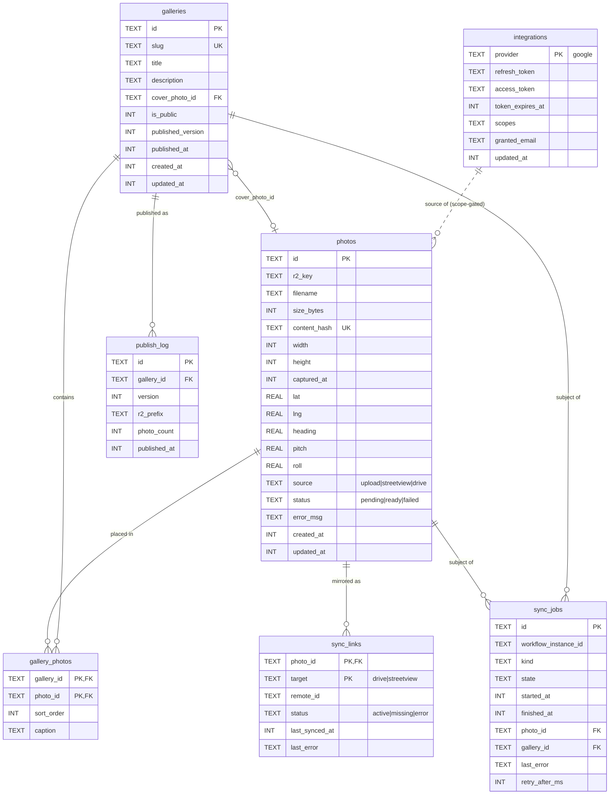
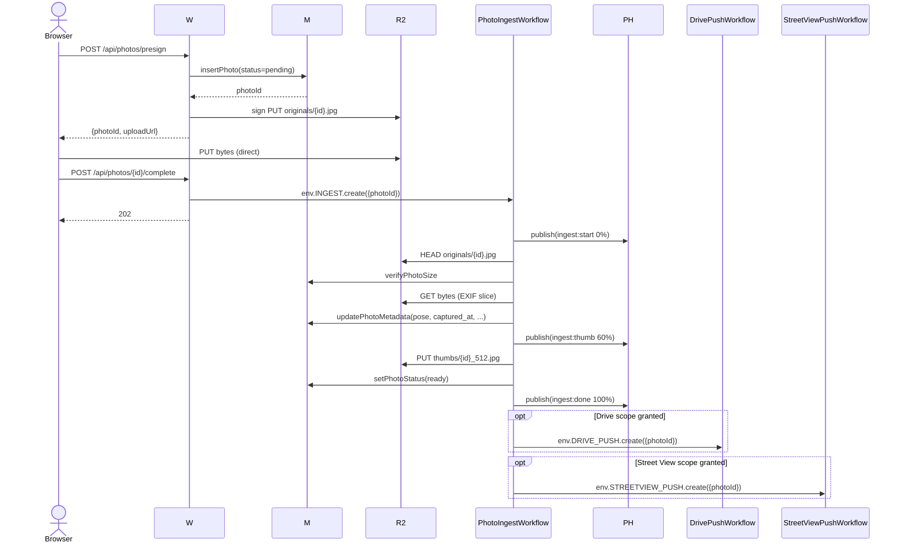
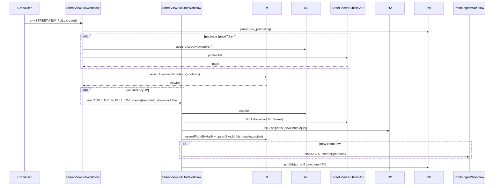
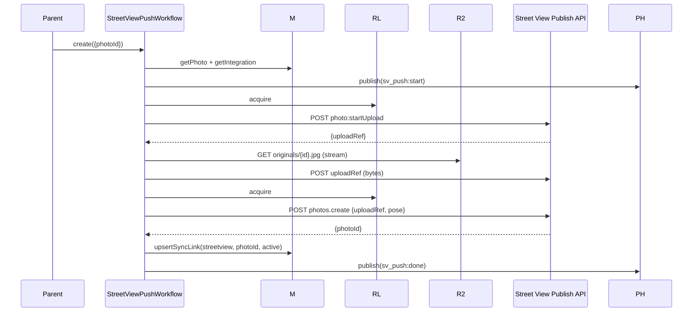
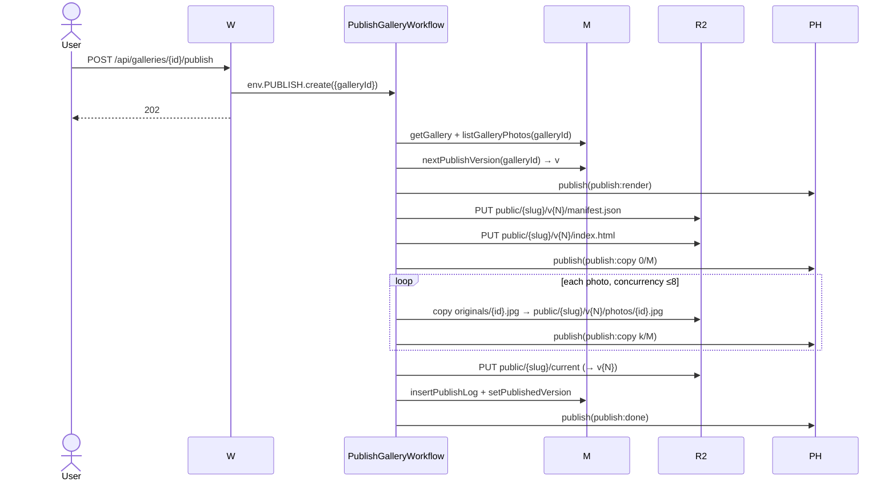
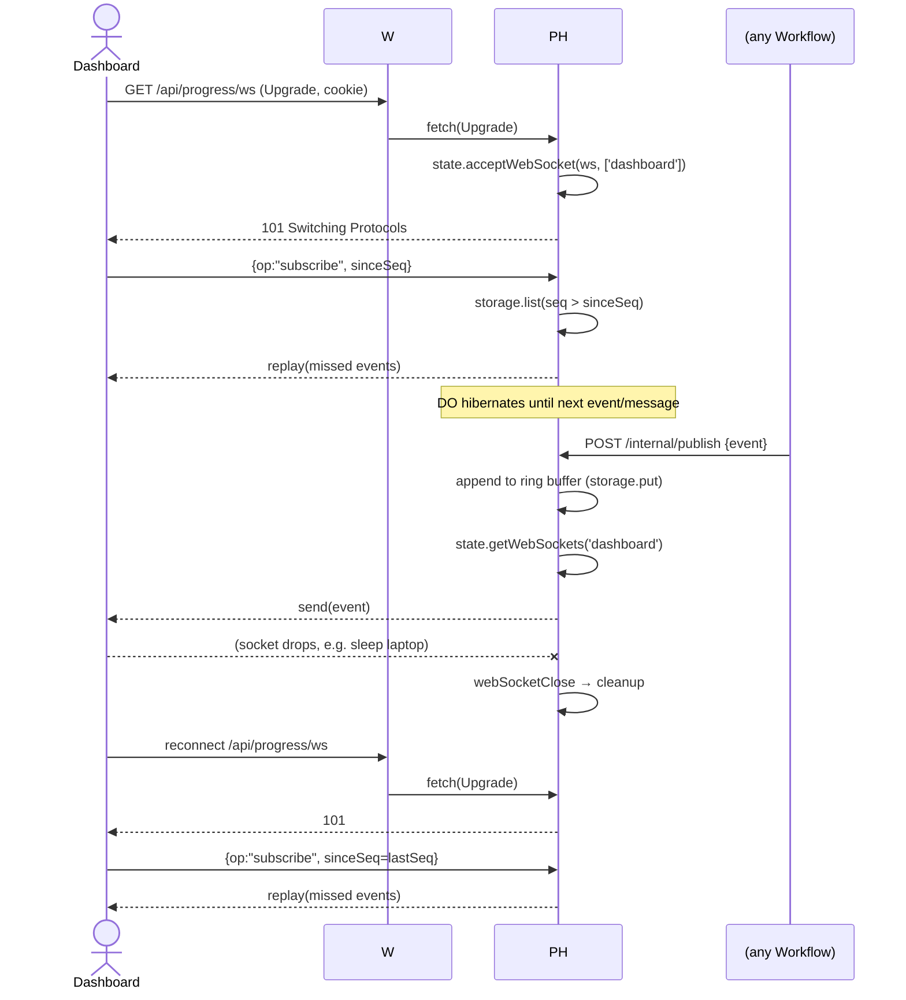
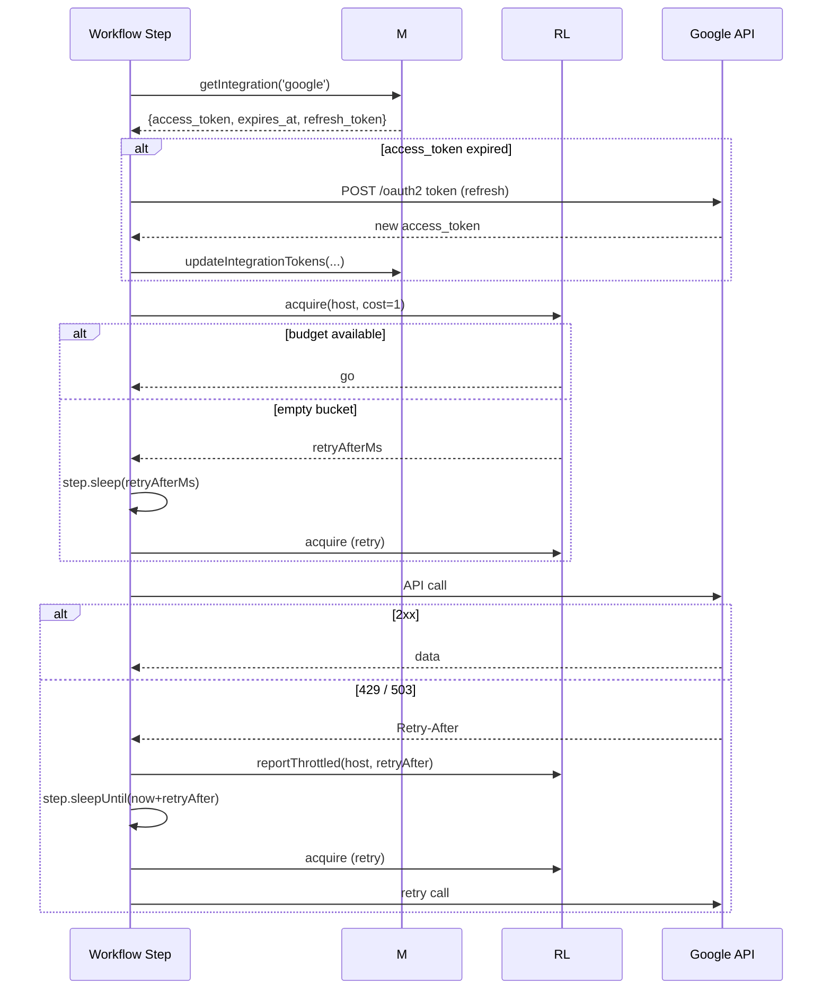

# Plan: Transform 360 Maps Photo Downloader → Self-Hostable 360 Photo Hosting Platform

## Context

The current project (`src/webapp.ts`, Express/Node on `localhost:3000`) is a **downloader**: it pulls a user's own Street View photos from Google and backs them up to Google Drive. We're pivoting the product identity: the primary feature becomes **hosting** 360 photos that the user uploads themselves (desktop/phone), with Street View and Google Drive as optional two-way sync integrations (both as sources and as destinations). Galleries can be published publicly. Display no longer depends on Google — the browser renders pano images with Three.js. Login is Google OAuth only.

Crucially, the project ships as a **single-user, self-hostable app**. Anyone can fork the repo, run `wrangler deploy` against **their own** Cloudflare account, and get their own 360 hosting site on their own domain, paying their own storage bill. That changes the architecture: no multi-tenancy, no wildcard subdomain routing, no tenant isolation design. The deployer's Google account is the only allowed login, enforced by a config value they set during setup. The existing Express app is deleted at cutover.

## Target Architecture

### Single-user, one deploy = one site

- One Cloudflare Worker.
- One **`MetaStore` Durable Object with SQLite backend** — all SQL metadata lives in a single DO (`env.META.idFromName("singleton")`).
- One R2 bucket (photo bytes + published gallery assets).
- Cloudflare **Workflows** for every long-running task (ingest, publish, sync).
- One **`GoogleRateLimiter`** Durable Object (token-bucket per Google API host).
- One **`ProgressHub`** Durable Object using **Hibernatable WebSockets** for live progress.
- One custom domain (e.g. `photos.example.com`), mapped to the Worker.
- Exactly one authorized Google account (`ALLOWED_GOOGLE_EMAIL` secret). Any other login is rejected after OAuth.

**Why DO SQLite over D1** — DO SQLite is the better fit for this shape of app:

1. **Strong consistency.** Workflow steps frequently read-modify-write `sync_links` / `photos.status`. DO SQLite gives read-your-writes on a single instance; D1 offers eventually-consistent read replicas, which would risk workflow replays seeing stale rows and double-pushing to Google.
2. **Single-writer is free.** The app is single-user and every write funnels through this DO — serialization is a feature, not a bottleneck, and it makes the "idempotent step" guarantees we rely on trivial to uphold.
3. **Colocation with compute.** Queries are sub-millisecond (in-process SQLite), which matters for the many small DB hits per workflow step and for `ProgressHub` event appends.
4. **Zero-step setup for self-hosters.** No `wrangler d1 create`, no separate ID to paste into `wrangler.toml`, no separate migrations command — the DO bootstraps its schema on first activation via `blockConcurrencyWhile(initSchema)`. One fewer thing for a fork-and-deploy user to do.
5. **Point-in-time recovery** and per-DO backups come built in.
6. **Size headroom.** Metadata-only (bytes live in R2); fits comfortably under the per-DO SQLite limit.

Workflows, the router, and `ProgressHub` all talk to the `MetaStore` DO through a small RPC-style façade (method-per-query) so callers never hand-craft SQL strings outside the DO.

### Routes (single domain)

- `GET /` — dashboard (auth required)
- `GET /auth/login`, `GET /auth/callback`, `POST /auth/logout` — Google OAuth
- `ALL /api/*` — authenticated JSON API
- `GET /{slug}`, `GET /{slug}/*` — public gallery read-through (R2 `public/{slug}/...`)
- `GET /assets/*` — app JS/CSS (R2 or embedded)

Private photo reads use short-lived R2 presigned GET URLs (or the read-through Worker with a signed cookie check), so Workers stay out of the hot path for warm public assets (edge cache) and off the path entirely for direct uploads.

### Storage Layout

Three storage surfaces, each owned by a different component:

| Store | Lives in | Holds |
|---|---|---|
| **MetaStore SQLite** | `MetaStore` DO | All durable business data: photos, galleries, sync links, OAuth tokens, job history |
| **ProgressHub storage** | `ProgressHub` DO | WebSocket-attached state + event ring buffer (~1 000 most recent events) |
| **Rate-limiter storage** | `GoogleRateLimiter` DO | Token-bucket counters per upstream host |
| **R2** | `PHOTOS` bucket | Photo bytes (originals, thumbnails) + published static gallery assets |

Progress events and rate-limiter state are **not** in MetaStore — they belong to the DOs that own them so MetaStore can hibernate independently and writes don't contend on the single-writer serialization.

#### MetaStore SQLite entities

Created by `initSchema()` under `blockConcurrencyWhile` on first activation; forward-only versioned migrations in `worker/src/meta-store/migrations.ts`.

- **`photos`** — the canonical record of one uploaded/pulled 360 image. Bytes live at `originals/{id}.jpg` in R2. One row is created `pending` at presign, promoted to `ready` when `PhotoIngestWorkflow` finishes. `content_hash` is the cross-source dedup key (same bytes from Drive and Street View converge to a single row).
  - `id` (TEXT, pk, uuid), `r2_key`, `filename`, `size_bytes`, `content_hash` (sha-256, indexed unique), `width`, `height`, `captured_at`, `lat`, `lng`, `heading`, `pitch`, `roll`, `source` (`'upload' | 'streetview' | 'drive'`), `status` (`'pending' | 'ready' | 'failed'`), `error_msg`, `created_at`, `updated_at`.

- **`galleries`** — a named collection users assemble and (optionally) publish. `slug` is the public URL segment. `is_public` + `published_version` drive the `public/{slug}/` render in R2.
  - `id` (pk), `slug` (unique), `title`, `description`, `cover_photo_id` (fk → `photos.id`, nullable), `is_public` (bool), `published_version` (int), `published_at`, `created_at`, `updated_at`.

- **`gallery_photos`** — many-to-many between galleries and photos, with ordering/caption.
  - `gallery_id` (fk), `photo_id` (fk), `sort_order` (int), `caption` (nullable). PK (`gallery_id`, `photo_id`).

- **`integrations`** — stored OAuth state per provider. One row per provider in single-user mode, but shaped to extend cleanly.
  - `provider` (pk, `'google'`), `refresh_token`, `access_token`, `token_expires_at`, `scopes` (space-separated), `granted_email`, `updated_at`.

- **`sync_links`** — the bridge between a local `photo` and its remote presence on Drive or Street View. Existence of a row = this photo is mirrored there. Status transitions (`active → missing → error`) encode remote deletion vs. transient failure. The composite PK makes sync steps trivially idempotent.
  - `photo_id` (fk), `target` (`'drive' | 'streetview'`), `remote_id`, `status` (`'active' | 'missing' | 'error'`), `last_synced_at`, `last_error`. PK (`photo_id`, `target`). Unique (`target`, `remote_id`) prevents two local photos from claiming the same remote id.

- **`sync_jobs`** — historical log of workflow runs (for the dashboard timeline + debugging throttles). Active state lives in Workflow instances; this is write-mostly audit.
  - `id` (pk, uuid), `workflow_instance_id` (Workflow instance id returned by `env.X.create`), `kind` (`'drive_pull' | 'drive_push' | 'streetview_pull' | 'streetview_push' | 'ingest' | 'publish'`), `state` (`'running' | 'succeeded' | 'failed' | 'throttled'`), `started_at`, `finished_at`, `photo_id` (nullable fk), `gallery_id` (nullable fk), `last_error`, `retry_after_ms` (nullable).

- **`publish_log`** — one row per successful gallery publish; powers "view past versions" and clean unpublish.
  - `id` (pk), `gallery_id` (fk), `version` (int, monotonic per gallery), `r2_prefix` (e.g. `public/my-trip/v3/`), `photo_count`, `published_at`.

#### ER diagram (MetaStore)



Key cardinalities in plain English:
- A **photo** may appear in many **galleries** via `gallery_photos`, and a gallery contains many photos.
- A **gallery**'s `cover_photo_id` points to zero or one **photo**.
- A **photo** has at most one **sync_link** per target (Drive, Street View) — enforced by the composite PK.
- A **gallery** has many **publish_log** rows (one per successful publish).
- **sync_jobs** point to either a photo (per-item job) or a gallery (publish job); both are nullable so listing/parent jobs can exist too.
- **integrations** is effectively 1-row in single-user mode; `photos.source` is gated by which scopes that row holds.

#### DO-private stores (not in MetaStore)

- **`ProgressHub`**: a ring buffer keyed by monotonic `seq` (kept in DO storage, capped ~1 000), plus the set of hibernatable WebSockets (managed by the runtime via `state.acceptWebSocket` tags). Event shape: `{ seq, workflow_instance_id, kind, phase, pct, message, ts }`.
- **`GoogleRateLimiter`**: one small record per host: `{ host, tokens, last_refill_at, cooldown_until }`. Keyed by host name.

#### R2 layout (single bucket, no user prefixing)

```
originals/{photoId}.jpg
thumbs/{photoId}_512.jpg
public/{slug}/v{N}/index.html        ← pre-rendered at publish (versioned for PITR + cache-bust)
public/{slug}/v{N}/manifest.json
public/{slug}/v{N}/viewer.js         ← Three.js bundle, content-hashed, immutable
public/{slug}/v{N}/photos/{id}.jpg   ← copy of original for public galleries
public/{slug}/current → v{N}         ← atomic "flip" handled via the Worker, not a real symlink
```

### Upload Flow (direct to R2, ingest via Workflow)

1. Client → Worker `POST /api/photos/presign` (filename/size/content-type).
2. Worker asks `MetaStore` DO to insert a `photos` row as `pending`, returns an S3-compatible **R2 presigned PUT URL** scoped to `originals/{photoId}.jpg`.
3. Browser `PUT`s bytes directly to R2 (no Worker request-size bottleneck).
4. Client → Worker `POST /api/photos/{id}/complete` → Worker starts a `PhotoIngestWorkflow` instance (`env.INGEST.create({ params: { photoId } })`) and returns immediately. The workflow handles all downstream work durably (see Workflows section).

### Display — Three.js Viewer (no Google dependency)

- `app/src/viewer.ts` — Three.js `SphereGeometry` (inverted normals) + equirectangular texture, drag/pinch controls, `DeviceOrientationEvent` gyroscope on mobile.
- Input: `manifest.json` = `{ title, photos: [{ id, url, pose, places }...] }`.
- Bundled by esbuild into a content-hashed `viewer.js`; cached immutably at the edge.

### Publishing & public galleries

- User flips `is_public = true` on a gallery and clicks **Publish**.
- Worker renders `index.html` + `manifest.json` from `MetaStore`, writes them plus the pinned `viewer.js` to `public/{slug}/` in R2.
- Viewable at `host.com/{slug}` via the read-through Worker, which sets long cache TTLs on immutable assets.
- Unpublish: delete `public/{slug}/` prefix and flip `is_public`.

### Google OAuth (login-only auth, single allowed account)

- Port OAuth logic patterns from `src/oauth.ts:27-139` to Workers `fetch` (no `googleapis` SDK — Node-only). Direct calls to `https://oauth2.googleapis.com/token` and `https://openidconnect.googleapis.com/v1/userinfo`.
- Sessions: signed JWT cookies (Web Crypto `HMAC-SHA256`). No `express-session`, no memory store.
- **Single-user gate**: after OAuth, compare `userinfo.email` against the `ALLOWED_GOOGLE_EMAIL` secret; reject everyone else with 403.
- Scopes requested **progressively** (incremental auth), refresh token persisted in `MetaStore` `integrations`:
  - Login default: `openid email profile`.
  - Street View sync (opt-in): `https://www.googleapis.com/auth/streetviewpublish`.
  - Drive sync (opt-in): `https://www.googleapis.com/auth/drive.file`.

### Cloudflare Workflows (all long-running work)

Every task that can take more than a few seconds, that needs to survive network blips, or that can be parallelized across many items is modeled as a Cloudflare Workflow. Workflows give us: durable step checkpoints, built-in step retries with exponential backoff, `step.sleep`/`step.sleepUntil` (for honoring `Retry-After`), multi-hour runtime, and distribution across the Workers fleet. Workflow instances are replayable, so each step must be idempotent — we enforce that by keying on `photoId` + `target` in `sync_links` before taking action.

Defined workflows (`worker/workflows/`):

1. **`PhotoIngestWorkflow`** — triggered on upload-complete or on pull from a remote source.
   - `step.do("verify-r2")` — HEAD object, confirm size matches `MetaStore` row.
   - `step.do("extract-metadata")` — run `piexifjs`/`xmp-js`, write via `MetaStore.updatePhotoMetadata`.
   - `step.do("thumbnail")` — resize via Cloudflare Images binding (or `@cf-wasm/photon` fallback), write to `thumbs/`.
   - `step.do("mark-ready")` — `MetaStore.setPhotoStatus(id, "ready")`.
   - `step.do("fan-out-sync")` — if Drive scope present, `env.DRIVE_PUSH.create({ params: { photoId } })`; if Street View scope, `env.STREETVIEW_PUSH.create(...)`.

2. **`DrivePullWorkflow`** — listing → per-file child workflows.
   - `step.do("list-folder")` — paginated Drive list via `fetch`, collect new fileIds not in `sync_links.drive`. Result persisted so retries skip the listing.
   - `step.do("enqueue")` — for each new fileId, `env.DRIVE_PULL_ONE.create(...)` (fan-out, runs in parallel across Workers).

3. **`DrivePullOneWorkflow`** — one file.
   - `step.do("download-to-r2")` — streamed GET from Drive → R2 presigned PUT (or direct via `PHOTOS.put`). Content hash computed on the fly.
   - `step.do("dedup-or-insert")` — if hash already present, link only; else create `photos` row, then start `PhotoIngestWorkflow` for the metadata pass.
   - `step.do("update-sync-link")`.

4. **`DrivePushWorkflow`** — one file.
   - `step.do("get-upload-url")`, `step.do("multipart-upload")`, `step.do("update-sync-link")`.

5. **`StreetViewPullWorkflow`** / **`StreetViewPullOneWorkflow`** — mirror Drive pull. Pull-one uses the existing `downloadUrl` + Bearer pattern from `src/photo-manager.ts:85-106`.

6. **`StreetViewPushWorkflow`** — one photo.
   - `step.do("start-upload")` → `photo:startUpload` to get upload URL.
   - `step.do("upload-bytes")` → PUT R2 bytes to the upload URL.
   - `step.do("create-photo")` → `photos.create` with pose metadata, store `photoId`.
   - `step.do("update-sync-link")`.

7. **`PublishGalleryWorkflow`** — gallery publish.
   - `step.do("render-manifest")`, `step.do("render-index")`, `step.do("copy-public-photos")` (fan-out per photo with concurrency cap), `step.do("record-publish")`.

**Trigger surface**
- Cron Trigger `*/15 * * * *` → starts `DrivePullWorkflow` and `StreetViewPullWorkflow` if the corresponding scope is present and sync is enabled.
- User actions in the dashboard (`/api/sync/drive/pull/run`, etc.) create workflow instances immediately.
- Upload completion and remote-pull hits start child workflows as above.

**Idempotency & dedup**
- Content hash is the dedup key across sources — same bytes from Drive and Street View collapse into one `photos` row with two `sync_links`.
- R2 wins on conflict. Remote deletions downgrade a `sync_link` to `missing` but don't delete the R2 original.
- Every step re-checks `sync_links` before acting, so a replay after a checkpoint never double-writes to Google.

### Live progress via Hibernatable WebSockets

Workflows are durable but silent; the dashboard still needs real-time progress for uploads, pulls, publishes, and push jobs. We use a single-instance **`ProgressHub` Durable Object** with **Hibernatable WebSockets** (`state.acceptWebSocket(ws, tags)`), which lets subscribers stay connected across long idle periods at near-zero cost — the DO hibernates between messages and wakes on event delivery.

- **`ProgressHub` DO** (`worker/src/progress-hub-do.ts`)
  - `GET /api/progress/ws` (upgraded) → the dashboard opens a WS. The hub calls `state.acceptWebSocket(ws, ["dashboard"])` so the connection is hibernatable. On reconnect the client sends the last `sequence` it saw; the hub replays any buffered events from DO storage since that sequence (recent ring buffer, ~1 000 events).
  - `POST /internal/publish` (called by workflow steps, not exposed publicly) → append event `{ seq, workflowId, kind, phase, pct, message, ts }` to the ring buffer and fan out to all live sockets tagged `dashboard`.
  - `webSocketMessage(ws, data)` — handles client pings and "subscribe since seq" replays.
  - `webSocketClose` / `webSocketError` — cleanup.
- **Workflow integration** — workflow steps emit progress through a tiny helper `progress(env, { workflowId, phase, pct, message })` which POSTs to the hub DO. Each `step.do` wraps its body with start/end progress events so a replay after a crash reproduces the same timeline. For fan-out workflows (Drive/Street View pull), the parent emits "N of M done" rolled up from child-workflow completions.
- **Client** — `app/src/progress.ts` opens the WS, keeps a `lastSeq`, reconnects with exponential backoff, and dispatches events into the dashboard's store. No polling.
- **Single-user scope** — because the whole deploy is one user, one `ProgressHub` singleton (`env.PROGRESS_HUB.idFromName("singleton")`) is sufficient; no per-user routing needed.

### API throttling (Google Street View + Drive)

Both Google APIs enforce per-project quotas (Drive: 1 000 req / 100 s / user default; Street View Publish: lower, per-minute QPS). Naive parallelism across workflow instances would trip these.

- **`GoogleRateLimiter` Durable Object** (`worker/src/rate-limiter-do.ts`) — one DO instance per Google API host (`drive.googleapis.com`, `streetviewpublish.googleapis.com`). Maintains a token bucket in DO storage (rate + burst configurable per host via secrets/config). Every Workflow step that calls Google wraps the call in `await env.RATE_LIMITER.get(hostId).acquire(cost=1)` before firing. The DO returns either "go" or a `retryAfterMs`; the step does `await step.sleep("rate-limit", retryAfterMs)` and re-acquires.
- **Response-driven backoff** — every Google `fetch` response is checked for `429` / `503`. On hit, read `Retry-After` (seconds) and call `step.sleepUntil(Date.now() + retryAfter * 1000, ...)` then retry; on the second consecutive 429, also tell the rate limiter to shrink its budget for that host for a cooldown window.
- **Per-workflow concurrency cap** — fan-out workflows (e.g. `DrivePullWorkflow` enqueuing `DrivePullOneWorkflow`) cap in-flight children (e.g. 4 for Drive, 2 for Street View), both to stay friendly to quotas and to keep a single 429 from starving the whole batch.
- **Batch endpoints** — Drive supports batch (`/batch/drive/v3`). We use it for metadata-only reads (listing, file-get) where it meaningfully cuts request counts; byte transfers stay per-file.
- **Observability** — every 429/`Retry-After` is logged to `MetaStore.sync_jobs.last_error` and surfaced in the dashboard so a self-hoster sees "throttled by Drive — waiting 32 s" instead of an opaque failure.

### Sequence diagrams

The diagrams below cover (1) every workflow end-to-end, (2) the reusable DO-to-DO patterns (rate-limited Google call, progress fan-out), and (3) the dashboard's hibernatable WebSocket lifecycle. They use the short names `W` = Worker router, `M` = `MetaStore` DO, `RL` = `GoogleRateLimiter` DO, `PH` = `ProgressHub` DO, `R2` = R2 bucket, `G` = Google API.

#### S1. Upload → `PhotoIngestWorkflow`



#### S2. `DrivePullWorkflow` (listing + fan-out) and `DrivePullOneWorkflow` (per-file)

```mermaid
sequenceDiagram
    participant Trigger as Cron/User
    participant DPW as DrivePullWorkflow
    participant DPO as DrivePullOneWorkflow
    participant M
    participant RL
    participant G as Drive API
    participant R2
    participant PH
    participant IWF as PhotoIngestWorkflow

    Trigger->>DPW: env.DRIVE_PULL.create()
    DPW->>PH: publish(drive_pull:listing)
    DPW->>M: getIntegration('google')
    loop paginate
      DPW->>RL: acquire(drive.googleapis.com)
      RL-->>DPW: go
      DPW->>G: files.list(folder, pageToken)
      G-->>DPW: page, nextPageToken
    end
    DPW->>M: selectUnknownRemoteIds(fileIds)
    M-->>DPW: newIds[1..N]
    DPW->>PH: publish(drive_pull:enqueue 0/N)
    loop bounded concurrency (≤4)
      DPW->>DPO: env.DRIVE_PULL_ONE.create({fileId})
    end
    note over DPW,DPO: parent workflow waits on children; children update progress directly

    DPO->>RL: acquire
    DPO->>G: files.get?alt=media (stream)
    DPO->>R2: PUT originals/{newPhotoId}.jpg (compute hash)
    DPO->>M: upsertPhotoByHash + upsertSyncLink(drive,active)
    alt new photo row
      DPO->>IWF: env.INGEST.create({photoId})
    end
    DPO->>PH: publish(drive_pull_one:done k/N)
```

#### S3. `DrivePushWorkflow`

```mermaid
sequenceDiagram
    participant Parent
    participant DP as DrivePushWorkflow
    participant M
    participant RL
    participant R2
    participant G as Drive API
    participant PH

    Parent->>DP: create({photoId})
    DP->>M: getPhoto(photoId) + getIntegration('google')
    DP->>PH: publish(drive_push:start)
    DP->>RL: acquire(drive)
    DP->>G: files.create (resumable init)
    G-->>DP: uploadUrl
    DP->>R2: GET originals/{id}.jpg (stream)
    DP->>G: PUT uploadUrl (stream bytes)
    alt 200
      G-->>DP: fileId
      DP->>M: upsertSyncLink(drive, fileId, active)
      DP->>PH: publish(drive_push:done 100%)
    else 429 / 503
      G-->>DP: Retry-After
      DP->>RL: reportThrottled(drive, retryAfter)
      DP->>DP: step.sleep(retryAfter); retry from acquire
    end
```

#### S4. `StreetViewPullWorkflow` / `StreetViewPullOneWorkflow`

Structurally identical to S2 but against `streetviewpublish.googleapis.com` using `listAllPhotos()` for the listing and the `downloadUrl`+Bearer flow (ported from `src/photo-manager.ts:85-106`) for each child. Concurrency cap is 2 (Street View Publish has tighter quotas than Drive).



#### S5. `StreetViewPushWorkflow`



#### S6. `PublishGalleryWorkflow`



#### S7. Dashboard ↔ `ProgressHub` over Hibernatable WebSocket



#### S8. Rate-limited Google call (pattern reused by every sync step)



### Deployment model (the key reason for this architecture)

The repo ships a `SETUP.md` and a minimal one-command path:

1. Fork repo, `npm i`.
2. Create a Google Cloud OAuth client (reuse existing instructions).
3. `wrangler login`, then:
   - `wrangler r2 bucket create photos`.
   - `wrangler secret put GOOGLE_CLIENT_ID / GOOGLE_CLIENT_SECRET / ALLOWED_GOOGLE_EMAIL / SESSION_KEY / R2_ACCESS_KEY_ID / R2_SECRET_ACCESS_KEY`.
4. `wrangler deploy` — the `MetaStore` DO bootstraps its SQLite schema automatically on first activation. Attach the custom domain in the Cloudflare dashboard.
5. Visit the domain, log in with the allowed Google account — done.

No D1 provisioning, no separate migration command, no tenant database to set up, no Workers-for-Platforms entitlements. Every cost goes to the deployer's own Cloudflare account.

## Files Changed / Created

**New (Workers backend, `worker/`):**
- `worker/wrangler.toml` — bindings: `META` (DO with SQLite backend, migration class `MetaStore`), `PHOTOS` (R2), `RATE_LIMITER` (DO), `PROGRESS_HUB` (DO with hibernatable WS), Workflow bindings (`INGEST`, `DRIVE_PULL`, `DRIVE_PULL_ONE`, `DRIVE_PUSH`, `STREETVIEW_PULL`, `STREETVIEW_PULL_ONE`, `STREETVIEW_PUSH`, `PUBLISH`), Cron Trigger, secrets
- `worker/src/meta-store/do.ts` — `MetaStore` Durable Object (SQLite backend). Exposes a typed method API (`insertPhoto`, `setPhotoStatus`, `upsertSyncLink`, `listGalleryPhotos`, …); holds the only `sql` statements.
- `worker/src/meta-store/migrations.ts` — forward-only schema migrations list; runs inside `blockConcurrencyWhile` on activation.
- `worker/src/meta-store/client.ts` — thin typed client used by Worker/workflows to call the DO.
- `worker/src/index.ts` — router (dashboard, `/auth/*`, `/api/*`, `/{slug}/*`, cron handler that starts pull workflows)
- `worker/src/oauth.ts` — Google OAuth over `fetch`, single-email gate (port of `src/oauth.ts`)
- `worker/src/session.ts` — JWT cookie helpers (Web Crypto)
- `worker/src/r2.ts` — S3-compat presigned PUT + head/get/delete helpers
- `worker/src/google-client.ts` — shared Google `fetch` wrapper: token refresh, rate-limiter acquire, 429/503 backoff, JSON + multipart helpers
- `worker/src/streetview.ts` — Street View Publish API calls (list/download/upload), consumed by workflows (ports `src/photo-manager.ts`)
- `worker/src/drive.ts` — Drive API calls (list/get/upload), consumed by workflows (ports `src/drive-manager.ts`)
- `worker/src/rate-limiter-do.ts` — `GoogleRateLimiter` Durable Object (per-host token bucket)
- `worker/src/progress-hub-do.ts` — `ProgressHub` Durable Object with Hibernatable WebSockets + event ring buffer
- `worker/src/publish.ts` — gallery static-site renderer helpers used by `PublishGalleryWorkflow`
- `worker/src/metadata.ts` — EXIF/XMP extraction (reuses `piexifjs`, `xmp-js`)
- `worker/workflows/photo-ingest.ts` — `PhotoIngestWorkflow`
- `worker/workflows/drive-pull.ts` — `DrivePullWorkflow` + `DrivePullOneWorkflow`
- `worker/workflows/drive-push.ts` — `DrivePushWorkflow`
- `worker/workflows/streetview-pull.ts` — `StreetViewPullWorkflow` + `StreetViewPullOneWorkflow`
- `worker/workflows/streetview-push.ts` — `StreetViewPushWorkflow`
- `worker/workflows/publish-gallery.ts` — `PublishGalleryWorkflow`

**New (client app, `app/`):**
- `app/src/main.ts` — dashboard SPA (auth state, upload, gallery manager, integration toggles)
- `app/src/viewer.ts` — Three.js 360 viewer
- `app/src/gallery-template.ts` — static gallery HTML template used by `publish.ts`
- `app/src/uploader.ts` — presign-then-PUT flow with progress
- `app/src/progress.ts` — Hibernatable-WebSocket client (auto-reconnect, replay-since-seq)
- `app/package.json` — `three`, `esbuild`, `piexifjs`

**Docs:**
- `SETUP.md` — step-by-step self-host guide (OAuth client, `wrangler` commands, custom domain)
- Update `README.md` — reframe as "self-hostable 360 photo hosting platform", keep the Street View/Drive lineage in a "History" section

**Ported from (then removed):**
- `src/photo-manager.ts:23-76` (list), `src/photo-manager.ts:85-106` (download) → `worker/src/streetview.ts`
- `src/drive-manager.ts` (folder+file CRUD, streaming upload) → `worker/src/drive.ts`
- `src/oauth.ts:27-139` → `worker/src/oauth.ts` (rewritten for `fetch` + email gate)
- `src/types.ts` `Photo` interface → `worker/src/types.ts`

**Deleted at cutover:**
- `src/webapp.ts`, `src/routes/`, `src/views/`, `src/public/`, `src/actions/`, `src/download-state.ts`
- Root deps: `express`, `express-session`, `memorystore`, `ws`, `ejs`, `googleapis`, `leaflet`, `leaflet.markercluster`, `axios`, `nodemon`, `@types/express*`, `@types/ejs`, `@types/leaflet*`, `@types/ws`, `prettier-plugin-ejs`

## Verification

1. `wrangler dev` locally (local DO SQLite + R2):
   - On first request, `MetaStore` applies migrations; subsequent restarts are no-ops.
   - Google OAuth login with the allowed email → JWT cookie set; `/api/me` returns profile. Log in with a different Google account → 403.
   - Upload a 20 MB equirectangular JPG from desktop → `MetaStore` row, bytes in R2 `originals/`, thumbnail generated, viewer renders and rotates.
   - Upload the same JPG from iOS Safari → mobile gyro control works.
2. Create a gallery, add photos, flip public, click Publish → `public/{slug}/index.html` + `manifest.json` appear in R2. Visit `host.com/{slug}` in incognito → viewer loads without auth. `wrangler tail` shows the read-through handler firing on cold paths only; warm hits are served by edge cache. Kill the DO mid-publish (`wrangler dev` restart) → workflow resumes and `MetaStore` rows reflect exactly-once publish (no duplicate `publish_log` entries).
3. Grant Street View scope → trigger `streetview_pull` from dashboard → after cron ticks, photos appear in dashboard; `sync_links.streetview` populated. Publish one platform-uploaded photo → appears in Street View (`streetview_push`).
4. Grant Drive scope → upload new photo in dashboard → appears in Drive folder (`drive_push`). Drop a JPG into the watched Drive folder → next `drive_pull` tick imports it; dedup suppresses re-import if the same bytes are already present from another source.
5. Open the dashboard → WebSocket to `/api/progress/ws` opens; start a Drive pull → progress events stream in live with percentage and per-file messages. Close the laptop for 10 minutes (DO hibernates), reopen → client reconnects and `since=lastSeq` replays missed events. Kill the workflow mid-run via `wrangler` → on restart, workflow resumes from the last checkpointed step and progress updates continue without double-counting.
6. Simulate API throttling: set the rate-limiter budget to 1 req / 10 s for Drive, start a pull of 20 files → workflow serializes correctly, `Retry-After` + 429 handling visible in progress stream; no steps fail permanently.
7. Follow `SETUP.md` end-to-end against a clean Cloudflare account → reach the final step and successfully log in on the deployed custom domain.
8. Logout → `/api/*` returns 401. Unpublish gallery → `host.com/{slug}` returns 404.

## Risks / Notes

- **Self-hosters without an allowed-email set**: the Worker refuses to start serving `/auth/callback` until `ALLOWED_GOOGLE_EMAIL` is configured, to prevent an accidentally-open instance.
- **R2 presigning** needs an S3 API token configured as two secrets on the Worker; signer is ~60 lines (Web Crypto).
- **`googleapis` replacement**: all Google calls become raw `fetch`s. Slightly more code but required — `googleapis` is not Worker-compatible.
- **Thumbnail generation in Workers**: prefer Cloudflare Images binding if enabled; fallback is a WASM resizer (`@cf-wasm/photon`) called inline on `complete`.
- **Cron Trigger cadence**: `*/5 * * * *` is cheap and good enough for hobby use; document how to tune it in `SETUP.md`.
